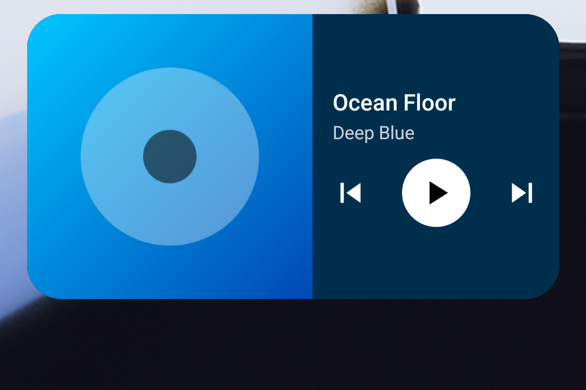
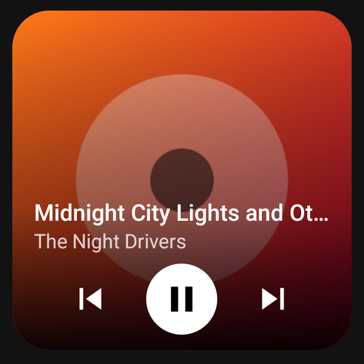
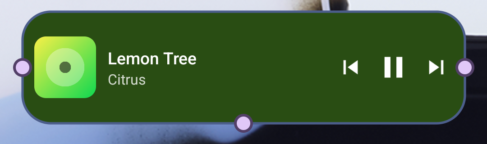

# Minimal Spotify Widget

A minimal Android home screen widget for the official Spotify app: album art, previous,
play/pause and next, and nothing else. No playlists, no account, no network access.
Unofficial; installs as "Now Playing Widget".

**Why:** Spotify's own widgets also show playlists, which got annoying. This one shows only
what's playing and the buttons to control it.

| 4×2 | 2×2 and taller | One row |
| --- | --- | --- |
|  |  |  |

- Tap the art to open Spotify's player.
- Remembers the last track, so it still shows it after Spotify is closed or the phone restarts.
- Play brings Spotify back in the background if it was closed, without opening it.
- The backdrop colour is taken from the album art.

Requires Android 12 or newer and the Spotify app.

## How it works

Android lets an app read another app's media session (track, artwork, play state) only if it
holds **notification access**. The widget uses that access for Spotify's media session and
nothing else; it does not read or store notifications, and the app has no internet permission.

When Spotify has no session, play tries, in order: Spotify's media browser service (the route
Android's own "resume" media card uses), then a media play key, which Android delivers to
whichever app played last. Previous and next need a running session; until then they open Spotify.

## Install

Build it (below) or take the APK from Releases, then:

```
adb install -r NowPlayingWidget.apk
adb shell cmd notification allow_listener com.nowplaying.widget/com.nowplaying.widget.MediaListener
```

Without adb: install the APK, open **Now Playing Widget**, and tap *Allow notification access*.
If Android greys the toggle out, open the app's App info page, tap ⋮, choose
*Allow restricted settings*, and try again.

Add the widget from your launcher's widget picker and resize it to taste.

## Build

No Gradle. Needs a JDK (17+) and the Android SDK with a platform (API 34+) and build-tools.

```
.\build.ps1
```

This produces `NowPlayingWidget.apk`, signed with a key it generates on first run
(`signing.keystore`, git-ignored). Keep that file: updates only install over a build signed
with the same key.

## Status

In use on a Pixel 9a (Android 17) with Spotify 9.2: track display, the three controls and
tap-to-Now-Playing work there. Resuming playback after Spotify was closed has been tested on an
emulator against a stand-in media app; with the real app it depends on Spotify and may vary
between versions.

## Legal

Not affiliated with, endorsed by, or sponsored by Spotify. "Spotify" is a trademark of
Spotify AB, used here only to say which app the widget controls. The widget contains no
Spotify code, artwork or logos and does not use the Spotify Web API or SDK.

Transport icons are from Google's Material Icons (Apache License 2.0). Code is MIT; see
[LICENSE](LICENSE).
